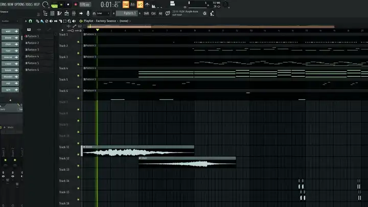
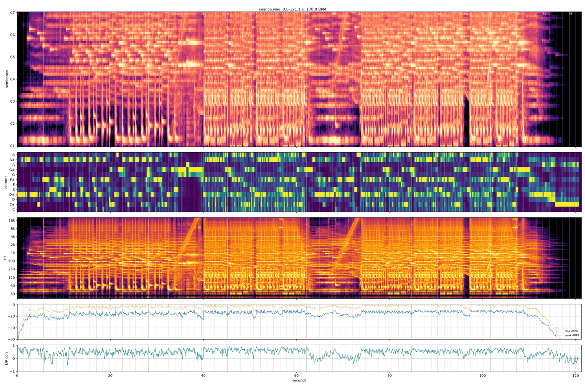

# kuruitsugizaki

An MCP server that lets a model read and write FL Studio projects and drive a running FL Studio, so it can write music. FL Studio is the first integration; the harness is meant to reach more software later.

The model does not listen. A render comes back as numbers and pictures (spectrograms, loudness, stereo width), and the person listens and decides.

**Factory Seance**, two minutes of glitchy witch house and breakcore, was written start to finish by Claude Opus 5.5 through this harness, in about 35 minutes: every note, drum hit, sound choice, mixer route and automation clip, from FL's factory sounds only. Nobody edited it; the person who asked for it listened afterwards and kept it as it was. Listen: [`examples/seance.mp3`](examples/seance.mp3), the clip with sound: [`examples/demo.mp4`](examples/demo.mp4), how it was made: [`examples/seance.md`](examples/seance.md).

https://github.com/user-attachments/assets/8ee80e6e-cf6b-459d-bbe1-a83a50da325c

<p align="center">


</p>

Windows only. To install it, follow `INSTALL.md`. Everything past setup and the tools (how to write a piece, the file format, traps, decisions) is under `docs/`, starting at `docs/INDEX.md`.

## Requirements

- Windows, FL Studio 2025. Built and measured on FL 25.1.6, scripting API 38.
- loopMIDI with at least one port. FL loads the controller script only when its MIDI input port exists.
- Python 3.12 or newer and `uv`.
- `ffmpeg` and `ffprobe` on PATH, for the analysis scripts.
- Serum 2 to use the Serum 2 channel of the template. FLEX ships with FL.

## Setup

The short way: close FL and double-click `setup.bat`. It installs what is missing (uv, loopMIDI, optionally ffmpeg), builds the environment, installs FL's controller script, makes the MIDI port and FL's MIDI setting, adds the server to the Claude desktop app, and ends with a check that FL answers. `INSTALL.md` lists every step and where it lands.

By hand, the same in four moves (`INSTALL.md`, By hand, has the detail):

```bash
uv sync
```

Register the server with the MCP client, with the path to this folder:

```json
"kuruitsugizaki": { "command": "<this folder>\\.venv\\Scripts\\kuruitsugizaki.exe" }
```

Then, in a chat with the model, FL closed:

1. It calls `config`. On a standard install every path is found by itself (FL under `Program Files\Image-Line`, the rest under your Documents folder) and shows as `detected`; for anything not found it asks you where it is and sets it; it does not guess. The keys are in `kuruitsugizaki.example.json`; what you set is stored in `kuruitsugizaki.json` here, which git ignores.
2. It calls `fl_install`, which writes the controller script into FL's `Settings\Hardware` folder with this folder's bridge path filled in, adds a loopMIDI port named `kuruitsugizaki` and assigns the script to it in FL's MIDI settings. Both of those live in the registry, and FL overwrites its own when it closes, which is why FL has to be closed.
3. Only when `fl_install` answers that it could not make the MIDI setting: in FL, Options, MIDI settings, select a loopMIDI input port, controller type **kuruitsugizaki**, and restart FL once.

Script output in FL shows `kuruitsugizaki {'api': 38, ...}` on load. `.venv\Scripts\python scripts\doctor.py` prints one line per requirement, any time.

The server opens FL only for a project: `project_write(open=true)` and `fl_render`. Other live tools answer that FL is closed instead of starting it; `fl_probe` starts it to test the link and closes it again, and a first-time saved plugin state is made in FL and FL closed again (Plugins by name). An FL you started yourself is used when it is the only one open, and the result says so; the server closes only FLs it started, and with several FLs open and none of them its own it does nothing until you close the extra ones. Before acting on an FL you started, the server copies the project it has open to `tmp/backups/<name>-<time>.flp`, once per project per server run; the result says where the copy went and whether FL holds unsaved changes the copy lacks. FL gives no path, so the file is found by its name in the window title, and an untitled project is not copied. When FL crashes, the server reads the cause from Windows' Application log (faulting module, exception code) and returns it; an FL the harness started is closed with its crash handler and the Windows crash dialog, while a crashed FL of yours keeps its dialog. When FL shows a dialog and stops answering, the result names it and saves a picture of it to `tmp/fl_dialogs/`, and nothing more is sent to FL while it is up. A harness FL whose project FL reports changed is saved before it is closed, so closing never stops at "Save changes?".

## Layout

| file | what |
|---|---|
| `scripts/server.py` | the MCP server: tools, and the live link to FL |
| `scripts/config.py` | the machine paths, read from `kuruitsugizaki.json` |
| `setup.bat`, `setup.ps1` | the one-step install (`INSTALL.md`, The short way) |
| `uninstall.bat`, `scripts/uninstall.py` | undoes the setup: controller script, the MIDI port and FL's MIDI setting, the Claude entries, saved plugin states; settings move to `tmp/uninstall`; uv, loopMIDI, ffmpeg and `.venv` stay |
| `Dockerfile` | for MCP directories' automated checks: runs the server on Linux, where the file tools work and the live link to FL answers that it needs Windows |
| `scripts/doctor.py` | `doctor.py [--install] [--claude [config]] [--live]`: one line per requirement of this machine's setup, `ok` or `MISSING` with what to do; `--install` runs `fl_install`, `--claude` adds the server to the Claude desktop app's config, `--live` starts FL, asks it for its API version and closes it again |
| `scripts/midisetup.py` | the loopMIDI port and FL's MIDI input setting, both in the registry: reads them, and makes them when no input has the script |
| `fl/device_kuruitsugizaki.py` | FL controller script; `fl_install` puts it in place |
| `scripts/flp.py` | `.flp` event codec: parse, serialize (byte-exact), notes, diff |
| `scripts/project.py` | `.flp` -> full project JSON (round-trips byte-identical) |
| `scripts/view.py` | compact and summary views, compact -> full |
| `scripts/style.py` | `style.py <folder> [out]`: the project list behind `profile` |
| `scripts/selftest.py` | what CI runs, no FL needed: templates round-trip, a project from shipped parts builds and reads back, profile, the server's tool list; on Windows with FL also every example |
| `scripts/writer.py` | project JSON -> `.flp`, template based |
| `scripts/automation.py` | automation points (event 234) and targets (event 227) |
| `scripts/levels.py` | mixer fader and main volume records in event 225 |
| `scripts/mixerfx.py` | mixer effect blocks: read one from any FL-saved project, place it in a track's slot |
| `scripts/presets.py` | puts a preset into a plugin channel's state: `.vital` (Vital), `.h2p` (Diva), `.fxp` (Sylenth1), `.SerumPreset` (Serum 2), `<pack>/<preset>` (FLEX) |
| `scripts/serum2.py`, `sylenth1.py`, `diva.py`, `flex.py` | each synth's preset format, and `<script> catalog [out.tsv]`: one TSV row per preset in that library |
| `scripts/catalog.py` | `catalog.py <preset folder> <out.tsv>`: Vital presets by style, oscillators, unison, effects on, macro names |
| `scripts/render.py` | `render.py <flp> [--close] [--reopen]`: FL's command-line render to wav and mp3 beside the project, then spectro and stereo stats. FL must be closed first; `--close` asks it to (never forced) |
| `scripts/spectro.py` | render -> PNG: semitone piano-roll spectrogram, chroma, 20 Hz-20 kHz spectrogram, RMS/peak, L/R correlation, ghost % over time with wash stretches (`wash.py`); `--bpm` adds bar lines. PNGs in `tmp/spectro/` |
| `scripts/wash.py` | the wash check `spectro.py` runs on every render: ghost % per 4 s window, stretches weighted by length and edge rate, head over trail, a score where over 18 is a wash (`docs/COMPOSING.md` §9) |
| `scripts/loudness.py` | integrated and momentary LUFS, LRA, true peak, RMS; `--zwicker` adds ISO 532-1 loudness in sones |
| `scripts/scope.py` | stereo density heatmaps per moment and band, `--timeline` for width over time |
| `scripts/waveshape.py` | A/B of several renders at several zooms around each file's loudest second |
| `scripts/onsets.py` | hit onsets of a WAV, for chopping loops |
| `scripts/chop.py` | cuts time ranges of a file into their own WAVs with short fades, optionally reversed |
| `scripts/vox.py` | vocal -> syllables with a median pitch each |
| `scripts/samples.py` | `samples.py <folder>`: per file duration, BPM and key from the name, levels, width, onsets, centroid -> `tmp/samples/<folder>.tsv` |
| `scripts/melstats.py` | per-instrument note overview of a project |
| `scripts/fxdump_fl.py` | sent through `fl_exec`: every effect on every insert of the open project with its parameters |
| `scripts/nudgemap.py`, `profiles/serum2/` | Serum 2 host-parameter mapping (parked) |
| `profiles/sylenth1/params.json` | Sylenth1's 244 parameter names in blob order |
| `projects/init/init.flp` | the template new projects are built from |
| `projects/init/fx.flp` | a library of FL's own effects to copy from |
| `examples/` | seven small documents, one per part of the format (instruments, effects, routing and sidechain, global, mixer and instrument automation), and a full two-minute piece with its script, notes and render; `examples/build.py` builds them all. Start at `examples/README.md` |
| `docs/params/` | parameter maps, one TSV per plugin: 27 of FL's own and 22 VST3s, listed in `docs/params/INDEX.md`; the `params` tool reads them |

## Tools

| tool | does |
|---|---|
| `config(key=None, value=None)` | no arguments: every path key, its value or the path detected for it, and whether it exists; with `key` and `value`: sets it |
| `fl_install()` | installs the controller script into FL's Hardware folder with the bridge path written in and, with FL closed and unless an input in FL already has the script, adds a loopMIDI port named `kuruitsugizaki` and assigns the script to it in FL's MIDI settings (`midisetup.py`); the answer's `midi` entry says what was done or what is left to do by hand |
| `project_read(path, view="compact", patterns=None, arrangements=None, unused=False)` | `.flp` -> JSON. `compact`: rows with pointers, the form `project_write` takes. `summary`: per-pattern stats and a per-track timeline. `full`: exact round-trip form |
| `project_write(doc, path, open=False, play=None)` | JSON (compact or full) -> `.flp`; `open` loads it in FL (launching FL if needed), `play` = `song` or `pattern` |
| `profile(folder)` | a table of the `.flp` projects under a folder (read only): tempo, key, arrangement length; which to open with `project_read`. Also written to `tmp/profile/<folder>/` |
| `fl_render(path, reopen=True)` | saves FL's open project, then runs `render.py <path> --close [--reopen]` detached; returns the log path under `tmp/render_logs/` |
| `fl_transport(action, mode=None, pattern=None)` | play / stop, song / pattern mode; needs a project open in FL |
| `plugins(query=None, native=False)` | the VST3 and CLAP plugins FL has installed, and every instance in the optional library project (see Plugins by name); `native=True` adds FL's own: name, instrument or effect, vendor, format, source, how many presets load by name, whether it has a parameter map |
| `presets(plugin, query=None, limit=200, harvest=False)` | a plugin's preset ids, filtered by words; the id goes into `project_write` as `preset`. When more than `limit` match, the list is an even spread across the preset folders, each folder an equal share, drawn anew on each call. `harvest=True` first reads the presets built into the plugin from FL (it opens the plugin there once, about a second per preset) |
| `params(plugin, query=None)` | a library plugin's parameters from `docs/params/`: index (for automation targets), name, saved value and display, and FL's display at 0, .25, .5, .75 and 1 where swept |
| `fl_exec(code, out=None, timeout=10)`, `fl_call(fn, args)`, `fl_probe()` | raw access to FL's Python API inside the running FL; `fl_exec` returns what the code assigns to `result`, or writes it as JSON to `out` (also when `result` is `{'__out__': path, 'data': value}`); they need FL open, and `fl_probe` starts it and closes it again |

`project_read`, `project_write`, `profile`, `plugins`, `presets` and `params` reload the codec modules on every call; a change to `server.py`, `flex.py` or `diva.py` needs an MCP restart, and a new tool reaches a client only in a session started after it.

## The template

`projects/init/init.flp`, saved by FL: a Sampler, Serum 2, FLEX, one audio channel and one automation clip; master plus inserts 1-17, no effects. Route to inserts 1-16: insert 17 takes no fader on this mixer. A `plugin` instrument is copied from the template channel of that plugin, so with this template `plugin` takes `serum2` or `flex`. Vital, Diva and Sylenth1 load by name with a preset (`{"kind": "plugin", "plugin": "Vital", "format": "vst3", "preset": "<id>"}`), into a state FL saved for them (Plugins by name); a template of your own holding them still works, matched by name: `Serum2`, `FLEX`, `Vital`, `Sylenth1`, `Diva(x64)`.

## Effects

An effect goes in by name: any effect FL has installed (Plugins by name). One can also be copied, with its settings, from a project FL saved. `projects/init/fx.flp` holds FL's own, set up as follows, and its first effect is also the block by-name effects are built on (config `effect_template`):

| from insert/slot | effect |
|---|---|
| 1/0 | Fruity Parametric EQ 2, saved with a band set (a high shelf at -18 dB); move or zero its bands before relying on it |
| 2/0 | Fruity Limiter |
| 3/0 | Fruity Limiter in compressor mode, set up for sidechain ducking |
| 4/0 | Fruity Reeverb 2 |
| 5/0 | Fruity Multiband Compressor |
| 6/0 | Soundgoodizer |
| 7/0 | Gross Beat |

Soundgoodizer and Gross Beat load only in an FL edition that includes them.

## Plugins by name

Every plugin FL has installed can go into a project by name, with nothing to prepare: FL's plugin manager keeps one entry per plugin in its Plugin database (`Documents\Image-Line\FL Studio\Presets\Plugin database`, config key `plugin_db`, found by itself), and the writer builds the plugin from it on the template's blocks, fresh, as dragging it in from FL's browser does. `plugins` lists them; `project_write` takes an instrument as `{"kind": "plugin", "plugin": "<name>", "preset": "<id>"}` and an effect as `mixer.effects: [{"track": t, "slot": s, "plugin": "<name>", "preset": "<id>"}]`. A plugin installed in several formats is one name; add `"format": "vst3"` (or `native`, `clap`, `vst`) to pick one. A plugin FL has not scanned is not listed: run FL's plugin manager first. `plugins` leaves out what config `hide_plugins` names: by default FL's controllers, visualizers and notebooks, the VFX and FL Studio Mobile entries, Fruity Delay 2 and the first Parametric EQ, and every VST2 build. An entry is a name or `*` pattern, `<format>:<name>` for one format only, or `category:<folder>` for a category of FL's Plugin database. Setting the key replaces the default list. A hidden plugin cannot be written by name either.

Optionally, one project FL saved can hold tuned instances you want reused as they are, each instrument on its own channel, each effect in a mixer slot; set its path as config key `library`. A library instance wins over a fresh one of the same name.

Presets, listed by `presets`:

- `.fst` files, from FL's factory and user Plugin presets folders (config keys `fl_presets`, `fl_user_presets`, found by themselves). FL writes one for any plugin from its plugin menu, VSTs included (a wrapped VST's go into `Fruity Wrapper - <name>`), so saving a sound there makes it usable by name.
- Vendor preset files, found by default for Krush (`ProgramData\Tritik\Krush`), Portal (`ProgramData\Output\Portal\Presets`), spiff (`ProgramData\oeksound\spiff\Presets`) and ShaperBox 3 (`APPDATA\Cableguys\ShaperBox3`, named by the preset name inside each file), and for any other plugin from the folders config key `vst_presets` names: `{"<plugin>": {"ext": ".vpreset", "dirs": {"": "<factory folder>", "user": "<user folder>"}}}`. An entry there replaces a plugin's default. JUCE XML presets whose plugin keeps more in its state than the preset holds, as Krush and spiff do, are merged into that state; the rest replace it.
- Serum 2, Vital, Sylenth1, Diva and FLEX presets, from each plugin's own default folder plus any folders config `serum2_presets`, `vital_presets`, `sylenth1_presets` (limited to `sylenth1_folders`) and `diva_presets` add, and from `flex_packs`. When a key has more than one folder, ids start with the folder's name. These presets, and vendor files from `vst_presets`, load into a saved instance of the plugin. The first time one is needed, `project_write` opens the plugin in FL, saves it, and keeps that state in `tmp/states/`, which takes a few seconds once per plugin.
- NKS `.nksf` presets for any VST3 plugin, matched to it by the plugin id inside the file, from Native Instruments' User Content, the libraries in Public Documents, and config `nks_presets`; they need no saved instance.
- Presets built into a plugin, for a VST3 plugin with a parameter named `Program`, such as TDR Kotelnikov: the harvest steps that parameter in FL and keeps each preset's state in `tmp/states/<plugin>.programs/`, dropping exact duplicates such as empty user slots. A plugin with no preset files shows them after `presets(plugin, harvest=True)`.

Parameter maps: open a copy of the library in FL (the sweep leaves every knob at 1) and send the text of `scripts/params_fl.py` through `fl_exec` once. Then `_kz_dump('tmp/params/pass1_all.json')`; for each v in 0, .25, .5, .75, 1, four separate `fl_exec` calls, `_kz_sweep(v, 'set')`, `_kz_sweep(v, 'nudge')`, `_kz_sweep(v, 'back')`, `_kz_read('tmp/params/sweep_<v>.json')` (a display read in the call that set it is stale); then `python scripts/parammap.py` writes `docs/params/`. Each function takes `only` and `skip` lists of plugin names as FL reports them (`docs/params/INDEX.md`, column `as FL names it`).

## Project JSON, compact form

```json
{
 "format": "compact",
 "base": "projects/init/init.flp",
 "project": {"bpm": 175, "ppq": 96},
 "instruments": [{"id": "lead", "kind": "plugin", "plugin": "serum2", "preset": "C:/presets/lead.SerumPreset", "mixer": 1},
                 {"id": "keys", "kind": "plugin", "plugin": "flex", "preset": "Hard 808s/808 Clean Fuzz", "mixer": 2},
                 {"id": "pad", "kind": "plugin", "state": {"from": "projects/my_song.flp", "channel": 3}, "mixer": 3}],
 "samples": [{"id": "snare", "kind": "audio", "path": "C:/samples/snare.wav", "mixer": 8}],
 "automation": [{"id": "fade", "kind": "automation", "target": {"mixer": 0, "param": "vol"}, "points": [[0, 0.8], [32, 0.0]]}],
 "mixer": {"volume": {"1": 0.729, "7": 0.434}, "main_volume": 0.6625},
 "note_cols": ["bar", "beat", "tick", "len", "key", "vel", "inst"],
 "patterns": [{"id": "lead_a", "notes": [[1, 1, 4, 66, "A#4", 96, 0], [1, 2, 3, 18, "G#4", 80, 0]]}],
 "clip_cols": ["track", "bar", "beat", "tick", "len", "src", "trim?"],
 "arrangements": [{"name": "Arrangement", "clips": [[5, 17, 1, 0, 1536, "lead_a"], [4, 17, 3, 0, 31, "s0"], [20, 1, 1, 0, 27648, "a0"]]}]
}
```

- **Time**: `[bar, beat, tick]`, 1-based bar and beat, 96 ticks per beat, 4/4. Lengths in ticks. Exact integers; no grid is imposed.
- **Keys**: note names, MIDI 60 = C4 (FL's own UI calls MIDI 60 C5). Flats accepted.
- **Pointers**: a note's `inst` is an index into `instruments`. A clip's `src` is a pattern id, `s<N>` (sample N) or `a<N>` (automation N), so no instrument or pattern id may look like `s1` or `a1`.
- **Patterns** hold notes for any number of instruments. A clip's `len` sets how much of a pattern plays.
- **Instruments**: `state: {from: file, channel: n}` copies that channel whole, preset and routing included, from any FL-saved project, switched on even when it was muted there (`muted: true` keeps it off; `project_read` reports a muted channel with `muted: true`); or a template `plugin` (see The template). `preset` loads a sound into it: an id from `presets`, or a `.SerumPreset`, `.vital`, `.h2p` or `.fxp` path, or `<pack>/<preset>` for FLEX. `mixer: n` routes it. Serum 1 `.fxp` are not supported.
- **Sampler channels**: `"kind": "sampler"` with a `path` loads that file into a sampler, so notes pitch it (C4 = original pitch). A sampler plays its sample to the end whatever the note length; cut chops to their own files first (`chop.py`).
- **Song mode**: compact documents are saved in song mode so FL and its command-line render play the arrangement; `project.song_mode: false` saves pattern mode.
- **Samples**: `path`, or `state` to copy one. An audio clip without `trim` plays the whole sample; `trim` is `[start_ms, end_ms]` into the sample. A path may start with `%FLStudioFactoryData%`, FL's own token for its install folder, so `%FLStudioFactoryData%/Data/Patches/Packs/Drums/Kicks/808 Kick.wav` finds FL's factory kick on any machine.
- **Project info**: `project` takes `title`, `author`, `genre` and `comment`, written into FL's project info (FL shows the title in its window), and `project_read` returns them.
- **Automation**: `points` are `[beat, value, tension?]` in beats from the clip start. Targets: `{"global": "tempo" | "main_pitch"}`, `{"mixer": t, "param": "vol" | "pan" | "sep"}` (insert 0 is the master: its fader is the overall level), `{"mixer": t, "slot": s, "param": n}` (effect parameter n), `{"mixer": t, "slot": s, "rec": "0x1f00"}` (the slot's mute) or `"0x1f01"` (its mix), `{"channel": id, "param": n}` (instrument parameter n) or `{"channel": id, "param": "vol" | "pan" | "pitch" | "fcut" | "fres" | "mute"}`. Values: tempo = (bpm - 60) / 120; main pitch 0.5 in tune, +-12 semitones; mixer volume 0.8 = 0 dB; pan 0 left, 0.5 centre, 1 right; sep 1 mono, 0 widest; channel pitch 0.5 in tune, +-48 semitones; channel volume 0.78 is FL's default. `{"global": "main_vol"}` is written but FL 2025 ignores it. `examples/README.md` lists the scales measured so far (fcut, fres and mute are written but their scales were not measured).
- **Mixer effects**: `mixer.effects: [{"track": 0, "slot": 9, "from": {"file": "projects/init/fx.flp", "track": 2, "slot": 0}}]` copies that effect with its settings into the given slot, replacing what was there.
- **Mixer routes**: `mixer.routes: [{"from": 11, "to": 10, "level": 0.0}]` routes insert 11 to insert 10; `level` 0 is a sidechain-only send, which is what a sidechained limiter or compressor listens to. `"on": false` removes a route.
- **Mixer volume**: `mixer.volume` maps insert -> fader, 0.8 = 0 dB; `main_volume` is FL's global main volume.
- **base**: the file whose globals, unmapped sections, arrangement track templates and mixer are kept. Building on one of your own projects keeps its mixer chains. Default: the `template` key.

The compact form leaves out bytes that are not mapped. For editing an existing project without losing anything, use `view="full"`.

## Not written yet

Mixer pans and sends as static settings; a plugin FL's plugin manager has not scanned; pattern names; time signature; vendor preset files for VSTs whose state is neither JUCE XML nor `#zip#` (an `.fst` saved from FL is their route). See `docs/FLP.md`, Open.

## License

MIT, see `LICENSE`. It covers this code and these docs, not FL Studio, the plugins or their presets.
